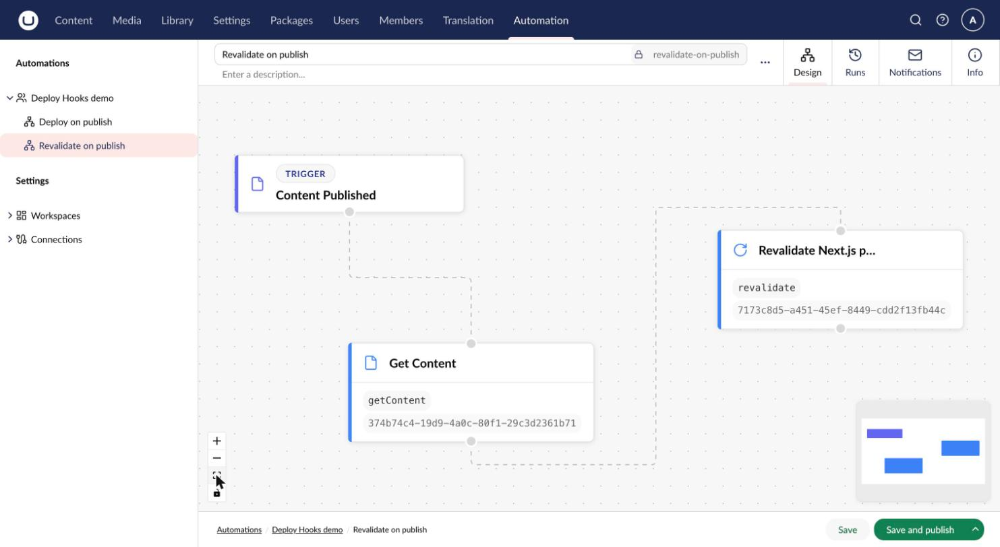

# Deploy Hooks

Automate actions that trigger Vercel, Netlify and Cloudflare Pages deploy hooks and Next.js revalidation, with coalescing of bulk publishes.

[](https://github.com/PascalA94/Umbraco.Community.Automate.DeployHooks/actions/workflows/build.yml)
[](https://www.nuget.org/packages/Umbraco.Community.Automate.DeployHooks)
[](https://www.nuget.org/packages/Umbraco.Community.Automate.DeployHooks)
[](https://github.com/PascalA94/Umbraco.Community.Automate.DeployHooks/blob/main/LICENSE)

A community package, not made or supported by Umbraco HQ. Requires Umbraco 17.8 or later with Umbraco Automate 17.5.1 or later, Umbraco 18.3 or later with Automate 18.5.1 or later, or Umbraco 19.0.0-rc1 or later with Automate 19.0.0-rc1 or later (release candidate). .NET 10 for 17 and 18, .NET 11 for 19.

Built against Umbraco 19.0.0-rc1, not yet verified on 19 stable.



## What it does

When content changes, tell your headless front end:

- **Trigger deploy hook:** calls a Vercel, Netlify or Cloudflare Pages deploy hook (a full rebuild).
- **Revalidate Next.js paths and tags:** calls a Next.js route that runs `revalidatePath` and `revalidateTag`, so only the changed pages refresh.
- **Coalescing:** 50 pages published in one go give one hook call, not 50.

### Why not the HTTP Request action?

HTTP Request can call a hook, but the hook URL then sits in the step settings, run data and exports, and anyone who can edit an automation can read it. Here the hook URL and the revalidate secret live in configuration, outside the database. A connection holds only a **name**. Nothing in a step, a run record, an export or the package's own log lines carries the URL or the secret. (The HTTP client's own logging and tracing are a separate residual: see Security.)

## Compatibility

| Package version | Umbraco | Automate |
|---|---|---|
| 19.x (release candidate) | 19 (19.0.0-rc1 or later) | 19.0.0-rc1 or later |
| 18.x | 18 (18.3.0 or later) | 18.5.1 or later |
| 17.x | 17 (17.8.0 or later) | 17.5.1 or later |

## Install

```bash
dotnet add package Umbraco.Community.Automate.DeployHooks
```

## Quick start

About ten minutes, from install to a working automation. Each step links to the detail further down.

1. **Install** the package (above) and restart the site.
2. **Set the credential** in an environment variable or secret store, never in `appsettings.json`. Pick a name, for example `mysite`. A deploy hook needs `DeployHookUrl`. Revalidation needs `RevalidateUrl` (the full `https://…/api/revalidate` address) and `RevalidateSecret`. See [Set up credentials](#set-up-credentials).
3. **Make sure Automate has a workspace** (Automate section, Workspaces). It needs a service account (an Umbraco API user), a user group, and the connections you are about to make listed under **Allowed Connections**. A connection that is not allowed in the workspace will not appear in its automations.
4. **Create a connection** (Automate, Connections, Create): **Deploy hook** (pick the provider) and/or **Next.js revalidation endpoint**. Enter the credential name, save, then press **Test connection**. Add it to the workspace's Allowed Connections.
5. **Build an automation** in the workspace, then **Save and publish** it:
   - To rebuild: **Content Published**, then **Trigger deploy hook**.
   - To refresh pages only: **Content Published**, then **Get Content** (Content Key `${ trigger.contentKey }`), then **Revalidate Next.js paths and tags** (Paths `${ steps.getContent.url }`). The site needs the [revalidate route](#the-revalidate-contract-version-1).
6. **Publish a page** and open the automation's **Runs** tab. Coalesced steps finish at once and a failing hook is logged at Warning, so set `Coalesce seconds` to `0` while you are testing to see failures in the run.

## Set up credentials

A credential is a **name** you choose (lower case letters and digits, 1 to 32 characters, for example `mysite`) plus values kept in configuration under `Umbraco:Automate:DeployHooks:Credentials:<name>:`.

| Part | Used by |
|---|---|
| `DeployHookUrl` | Deploy hook connection |
| `RevalidateUrl` | Next.js revalidation connection |
| `RevalidateSecret` | Next.js revalidation connection |

Set them as environment variables, a secret store or Key Vault. **Do not put them in `appsettings.json`**: Test connection warns if they come from there, because that file is usually committed.

```bash
export Umbraco__Automate__DeployHooks__Credentials__mysite__DeployHookUrl='<the hook URL from your provider>'
export Umbraco__Automate__DeployHooks__Credentials__mysite__RevalidateUrl='https://www.example.com/api/revalidate'
export Umbraco__Automate__DeployHooks__Credentials__mysite__RevalidateSecret='<a long random secret>'
```

- **Azure:** App Service application settings (or Key Vault references) with the same names.
- **Umbraco Cloud:** the credential store reads configuration, so Cloud environment settings should work. Whether each Cloud environment resolves its own value has **not been verified**. Check it on your project before you rely on it.
- The `Umbraco:Automate:DeployHooks:Credentials` section is deliberately kept out of Automate's `AllowedConfigurationKeyPrefixes`. **Never add `Umbraco:Automate` to that list.** It would let any automation author read these values through the HTTP Request action. The package logs a Critical message at start-up and refuses to read the credential if it finds this, but it cannot stop the exposure. If it ever happened, rotate the credential and purge run records. Changes to the list need a restart.

### Where to get a deploy hook

| Provider | Create it in | The URL starts with |
|---|---|---|
| Vercel | Project, Settings, Git, Deploy Hooks | `https://api.vercel.com/v1/integrations/deploy/` |
| Netlify | Site configuration, Build and deploy, Build hooks | `https://api.netlify.com/build_hooks/` |
| Cloudflare Pages | Settings, Builds, Deploy hooks | `https://api.cloudflare.com/client/v4/pages/webhooks/deploy_hooks/` |

A hook URL on any other host or path is refused before a request is sent. (These prefixes come from the providers' public documentation. If a provider changes its URL shape, override it with `ProviderHosts`, below.)

## Use

1. **Create a connection** in Automate: **Deploy hook** or **Next.js revalidation endpoint**. Enter the credential name, and for a deploy hook pick the provider.
2. **Test connection.** The deploy hook test checks the credential and host and **does not call the hook** (a rebuild costs build minutes). The revalidation test sends `{"paths":[],"tags":[],"test":true}`, which revalidates nothing.
3. **Add an action** to an automation: **Trigger deploy hook** or **Revalidate Next.js paths and tags**.

**"The endpoint refused the secret" on Vercel?** Any 401 gives that message, including one from Vercel itself. If the site has **Vercel Authentication** (Deployment Protection) on, Vercel answers 401 before your route runs, however right the secret is. Use the project's production domain (not a per-deployment URL with a hash in it) and check Settings, Deployment Protection. A request with no secret should reach your route and get its own 401.

### Connection settings

| Setting | Default | Notes |
|---|---|---|
| Credential name | | A name, never a URL or secret. Pasting one is refused when you save. |
| Provider (deploy hook) | Vercel | Picks the host rule. |
| Coalesce seconds | 60 (deploy), 10 (revalidate) | 0 to 600. Wait this long after the last request. `0` sends every request at once. |
| Maximum wait seconds | 300 (deploy), 60 (revalidate) | 1 to 3600. A steady trickle still sends at least this often. |

### Revalidation paths

The **Paths** field takes one path per line, and **Tags** one tag per line. Both accept bindings.

- Automate's **Content Published trigger output has no URL.** Add a **Get content** step and bind its **Url** output to the Paths field with the binding picker. Do not look for a `url` on the trigger.
- The trigger starts **one run per published item**, so publishing a page with 10 descendants that Umbraco republishes should start about 11 runs. (Confirmed on a running Automate 18.5.1 site: one run per published item. Umbraco's Publish only republishes descendants that changed.) Coalescing merges them into one call. The **Content Batch Published** trigger runs once per publish, but it also has no per-item path, so you would still need a **For each** loop with Get content.
- A path is cleaned, not trusted. An absolute URL is cut to its path, and the query and fragment are dropped. A value that does not start with `/`, starts with `//`, holds a backslash or control character, or is over 1,024 characters is dropped with a warning that never repeats the value.
- A tag may use letters, digits and `: _ - . /`, up to 256 characters. Others are dropped with a warning.
- If nothing is left after cleaning, the step succeeds, sends nothing and says so in `Warnings`.
- Bad data never fails a step.

### Step output

| Action | Output |
|---|---|
| Trigger deploy hook | `Status` (`Sent`, `Queued` or `Joined`), `BatchId`, `StatusCode` and `ProviderJobId` (only when `Sent`), `Warnings` |
| Revalidate | `Status`, `BatchId`, `StatusCode`, `PathCount`, `TagCount`, `Warnings` |

`Queued` and `Joined` share a `BatchId`: every step that was merged into one call reports the same one.

## Coalescing

Each connection and action kind keeps one pending batch in memory. A trailing debounce fires `Coalesce seconds` after the last request, but never later than `Maximum wait seconds` after the first. A request that arrives while a batch is being sent starts a new batch. On a clean shutdown, a pending batch is sent once.

- **Coalesced steps succeed at once.** A failing hook or endpoint is logged at Warning, not shown in the run. Only transient failures (timeouts, throttling, 5xx, network errors) are retried, at 5 s and 30 s; a refusal such as a wrong secret or a deleted hook is not. A deploy hook call is not idempotent: if a request times out after the provider has already started the build, the retry can start another, so one batch can start up to three builds (the first call and two retries). A wrong credential still fails the step at once. **Set `Coalesce seconds` to `0` where you need to see a failure in the run.**
- **Single server:** one call per window. **Load-balanced back offices:** each server coalesces by itself, so N servers can send up to N calls per window. Shared state across servers is not built.
- **A crash loses a pending batch.** The next publish triggers again.
- Memory is bounded: one batch per connection and kind, up to 2,000 paths and 2,000 tags each. Beyond that, items are dropped and only a count is logged.
- Two connections that share a credential name coalesce separately.

## The revalidate contract (version 1)

The package sends:

```
POST <RevalidateUrl>
Authorization: Bearer <RevalidateSecret>
Content-Type: application/json

{"paths":["/news/a"],"tags":["news"]}
```

A call with `"test": true` must answer 200 and do nothing. Batches over 100 paths plus tags (`MaxItemsPerCall`) are split into several calls. The JSON shape is frozen: new fields are additive, and a breaking change would be a new action. Any framework can implement it.

A sample App Router route handler (`app/api/revalidate/route.ts`), written for Next.js 15:

```ts
import { revalidatePath, revalidateTag } from "next/cache";
import { timingSafeEqual } from "node:crypto";

function authorised(header: string | null): boolean {
  const secret = process.env.REVALIDATE_SECRET;
  if (!secret || !header?.startsWith("Bearer ")) return false;
  const given = Buffer.from(header.slice(7));
  const wanted = Buffer.from(secret);
  return given.length === wanted.length && timingSafeEqual(given, wanted);
}

export async function POST(request: Request) {
  if (!authorised(request.headers.get("authorization"))) {
    return Response.json({ revalidated: false }, { status: 401 });
  }
  const body = await request.json();
  if (body.test === true) return Response.json({ revalidated: false, test: true });

  for (const path of body.paths ?? []) revalidatePath(path);
  // Next.js 16 changed revalidateTag to take a second argument; check your version's docs.
  for (const tag of body.tags ?? []) revalidateTag(tag);
  return Response.json({ revalidated: true });
}
```

## Optional configuration

Section `Umbraco:Automate:DeployHooks`:

| Key | Default | Notes |
|---|---|---|
| `TimeoutSeconds` | 15 | Per request. |
| `MaxItemsPerCall` | 100 | Larger revalidation batches are split. |
| `MaxBatchItems` | 2000 | Paths, and tags, held per pending batch, and the most one inline revalidate step sends. |
| `AllowedRevalidateHosts` | empty | When set, a revalidate URL must use one of these hosts. Empty allows any https host, and Test connection names the host to anyone who can run it. Set it in production. |
| `ProviderHosts:<Provider>:Host` and `:PathPrefix` | the table above | Replaces a provider's rule. Set both. Never settable per connection. |

## Security

- Requests are `https` only, never follow a redirect, and read at most 1,024 bytes of any answer. The package uses Automate's own no-redirect HTTP client, which is meant to block private and loopback addresses. That has not been proven here, and the URLs come from configuration, not from the backoffice.
- A hook URL that leaks lets anyone start free rebuilds. See `SECURITY.md` for rotation steps for each provider.
- **Hook URLs can reach host logs and telemetry.** A deploy hook's ID is in its URL path, and the .NET HTTP client records the path in two places the package does not control:
  - Logs: keep the `System.Net.Http.HttpClient` category above Information (Umbraco's default is fine).
  - Traces: any OpenTelemetry, Azure Monitor or Application Insights setup that collects outgoing HTTP calls records the full URL (the query is redacted, the path is not). If you export dependency telemetry, filter or redact calls to the provider hook hosts, or limit who can read it. A leaked hook URL lets anyone start builds, so treat telemetry access accordingly. (Inferred from the framework's behaviour; not tested against each vendor.)
- Credential names are site-wide: anyone who can create an Automate connection can use any configured credential by name.
- Hosts that add resilience handlers to every HTTP client (for example Aspire service defaults) may retry or log these requests too. Exclude this client if you can.

## Develop

See `CLAUDE.md` for the commands. In short: `dotnet restore src/Umbraco.Community.Automate.DeployHooks.slnx --locked-mode`, build, test; run the demo site under `demo/`.

## Licence

MIT. See `LICENSE`. Security issues: see `SECURITY.md`.
